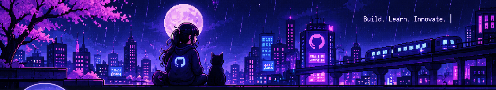

<!--
  PIXEL CYBERPUNK PROFILE README
  Replace the username if your GitHub username differs.
  Upload banner.png to the root of your profile README repository.
-->
<div align="center">
  

  <h1>Hi, I'm Harshitha Bhaskaran ✦</h1>
  <h3>AI / ML Engineer · Researcher · Computer Vision Enthusiast</h3>

  
</div>


## `~/about-me`

```text
🎓 M.Tech — Computer Science (AI & ML)
🔬 Interested in AI, Computer Vision, Deep Learning & intelligent systems
🫀 Currently building explainable AI for echocardiography analysis
📄 Research: AI-generated media & deepfake detection
🌱 Always learning, experimenting, and building
```


## `~/tech-stack`

<div align="center">
  
  <br/><br/>
  
  
  
</div>


## `~/featured-projects`

<table>
  <tr>
    <td width="50%" valign="top">
      <h3>🫀 Echocardiography AI</h3>
      <p>Explainable AI pipeline for cardiac analysis from echocardiography videos, including LV segmentation, cardiac measurements, visual explanations, and AI-generated reporting.</p>
      <p><code>Python</code> <code>U-Net</code> <code>ConvLSTM</code> <code>Grad-CAM</code> <code>LLM</code></p>
    </td>
    <td width="50%" valign="top">
      <h3>🕵️ Deepfake Detection</h3>
      <p>Research on detecting AI-generated and manipulated media using machine-learning and computer-vision techniques.</p>
      <p><code>Python</code> <code>Computer Vision</code> <code>Deep Learning</code></p>
    </td>
  </tr>
  <tr>
    <td width="50%" valign="top">
      <h3>📊 Data Analytics & BI</h3>
      <p>Data exploration, SQL workflows, and interactive business intelligence reporting to turn data into useful insights.</p>
      <p><code>SQL</code> <code>Power BI</code> <code>Data Analytics</code></p>
    </td>
    <td width="50%" valign="top">
      <h3>🤖 AI / ML Experiments</h3>
      <p>A growing collection of experiments, prototypes, and learning projects in machine learning and generative AI.</p>
      <p><code>Python</code> <code>ML</code> <code>GenAI</code></p>
    </td>
  </tr>
</table>


## `~/github-stats`

<div align="center">
  
  
  <br/>
  
</div>


## `~/contribution-map`

<div align="center">
  
</div>


## `~/connect`

<div align="center">
  <a href="https://harshithabhaskaran.github.io/Harshitha_Portfolio/"></a>
  <a href="https://www.linkedin.com/"></a>
  <a href="https://github.com/Harshithabhaskaran"></a>
</div>


<div align="center">\n  <h3>🌃 Code more. Worry less. Keep creating.</h3>
  <i>Thanks for stopping by my little corner of the internet ✨</i>
</div>
